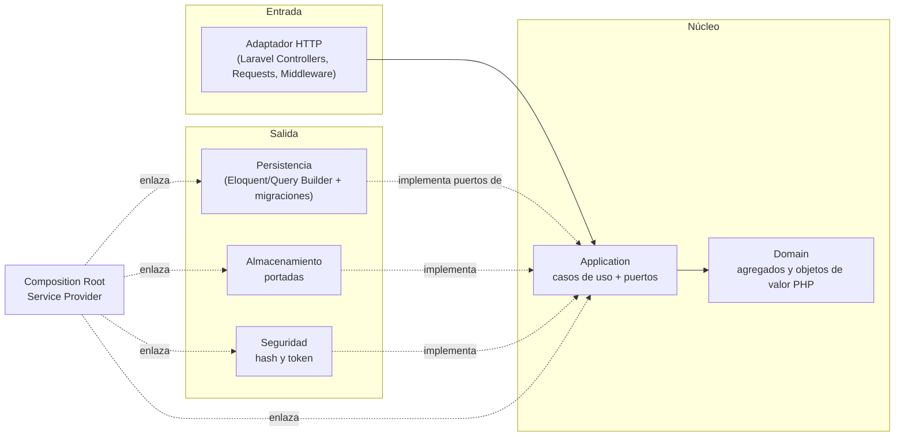
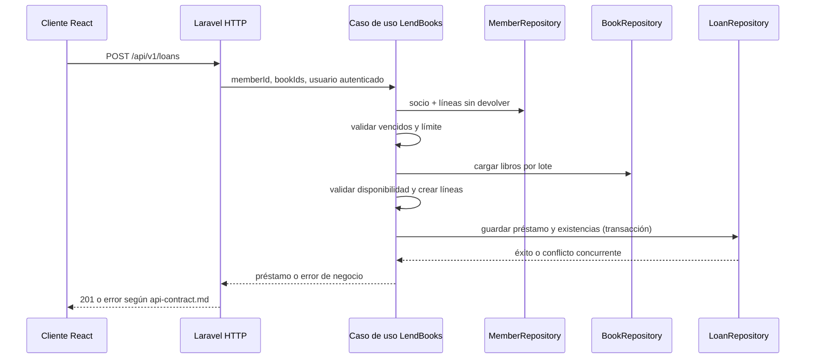

# Arquitectura — Manager Library (Laravel + React)

Se conserva la arquitectura **hexagonal** (puertos y adaptadores) definida en el spec de referencia:
las mismas capas, dirección de dependencias, puertos, adaptadores, agregados, flujo de préstamo y
límites. Este documento no propone una arquitectura nueva. Solo traduce los nombres y mecanismos
propios de Python/.NET a sus equivalentes de implementación en Laravel/PHP. Las reglas de dependencia
se verifican según [`constitution.md`](constitution.md); Laravel se mantiene en los adaptadores y en
la composición, no en el dominio.

| Elemento arquitectónico del spec | Mapeo de implementación Laravel |
|---|---|
| `domain` | `api/app/Domain/` |
| `application` (casos de uso y puertos de salida) | `api/app/Application/` |
| `adapters/inbound/http` | `api/app/Adapters/Inbound/Http/` (controladores, requests, middleware y resources Laravel) |
| `adapters/outbound/persistence` | `api/app/Adapters/Outbound/Persistence/` (repositorios y modelos Eloquent) |
| `adapters/outbound/storage` | `api/app/Adapters/Outbound/Storage/` |
| `adapters/outbound/security` | `api/app/Adapters/Outbound/Security/` |
| `bootstrap/composition` | `api/app/Bootstrap/Composition/` (Service Provider que enlaza los puertos) |

El mapeo cambia la ubicación/nomenclatura necesaria para convivir con Laravel; no cambia las
fronteras ni permite que las dependencias apunten hacia afuera del núcleo.

## 1. Capas y dependencias del backend



Las dependencias apuntan hacia el núcleo, como en el spec de referencia. Los modelos Eloquent
pertenecen al adaptador de persistencia; nunca son entidades de dominio ni tipos expuestos por
puertos. El Service Provider dedicado a la composición cumple el mismo rol que el único módulo de
`bootstrap/composition`: enlazar puertos y adaptadores.

## 2. Estructura propuesta del backend (`api`)

```text
api/app/
├── Domain/
│   ├── Book/
│   ├── Loan/
│   ├── Member/
│   ├── User/
│   └── Shared/
├── Application/
│   ├── Ports/Outbound/
│   └── UseCases/
├── Adapters/
│   ├── Inbound/Http/
│   │   ├── Controllers/
│   │   ├── Requests/
│   │   ├── Middleware/
│   │   └── Resources/
│   └── Outbound/
│       ├── Persistence/
│       │   ├── Eloquent/Models/
│       │   └── Repositories/
│       ├── Storage/
│       └── Security/
└── Bootstrap/Composition/
    └── LibraryServiceProvider.php

api/database/
├── migrations/
└── seeders/
```

Laravel mantiene sus carpetas estándar de rutas, configuración y pruebas. Las migraciones son
infraestructura propiedad de la aplicación. El Service Provider de composición se registra en el
bootstrap estándar de Laravel; no se crean instancias de adaptadores en controladores ni casos de
uso.

## 3. Frontend (`app`)

React consume únicamente el contrato `/api/v1` mediante un cliente HTTP centralizado. La UI no
contiene reglas de negocio ni accede directamente a la base. La organización por páginas,
componentes y funcionalidades debe mantener separados:

- presentación y navegación;
- estado y flujos de cada funcionalidad;
- cliente HTTP, manejo de sesión y traducción de errores del contrato.

La aplicación React se construye y ejecuta dentro de su contenedor. El detalle de herramientas y
estructura de carpetas del frontend se concreta antes de sus tareas de implementación, sin alterar
el contrato de Laravel.

## 4. Puertos y casos de uso

Los puertos viven en `Application` y usan tipos del dominio o tipos simples propios. Incluyen
`BookRepository`, `LoanRepository`, `MemberRepository`, `UserRepository`, `ReportReader`, `Clock`,
`PasswordHasher`, `TokenIssuer` y `CoverStorage`.

Los casos de uso incluyen `LendBooks`, `ReturnItem`, creación y búsqueda de libros, vencidos,
reporte, login y creación de bibliotecario. No reciben `Request`, `Model`, `Builder`, `Response` ni
facades de Laravel.

## 5. Agregados e invariantes

| Raíz | Contiene | Invariantes que defiende |
|---|---|---|
| `Book` | ISBN, copias totales/disponibles y baja lógica | disponibles entre 0 y total; total ≥ 1; título no vacío |
| `Loan` | Colección de líneas de préstamo | 1 a 3 líneas; sin libro repetido; vencimiento a 14 días; inmutable salvo devolución |
| `Member` | Documento | documento obligatorio y único |
| `User` | Rol y hash | usuario normalizado; rol `admin` o `librarian` |

Añadir una línea descuenta un ejemplar y crea la línea dentro de la misma transacción. Devolverla
repone exactamente una unidad y no permite una segunda devolución.

## 6. Flujo: registrar un préstamo



## 7. Errores y límites de tecnología

Dominio y aplicación expresan errores propios. El adaptador HTTP los traduce al cuerpo único y al
código de estado de [`api-contract.md`](api-contract.md); las excepciones internas no se devuelven
como trazas ni detalles de infraestructura.

No se incorporan eventos, colas, caché, microservicios ni multitenencia sin un requisito que los
justifique. La arquitectura no habilita ejecución local: desarrollo, pruebas y ejecución se realizan
con los contenedores definidos en el plan.
