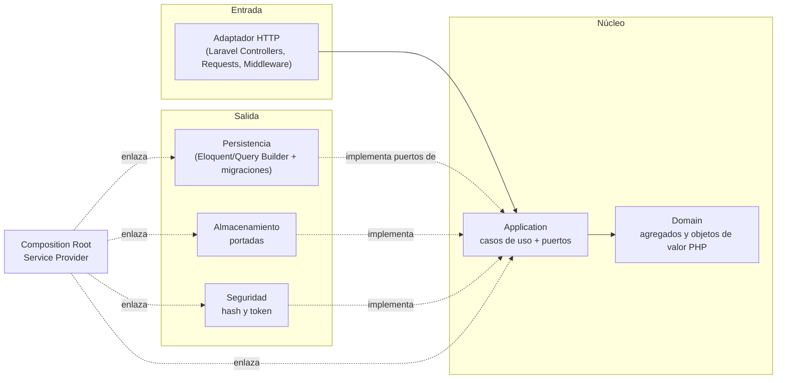
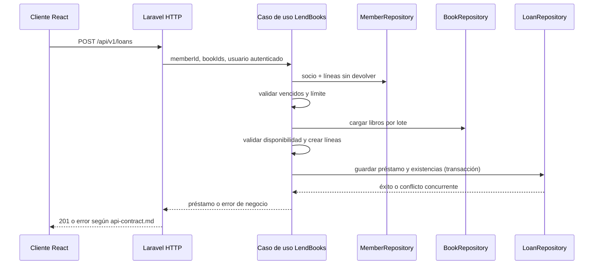

# Arquitectura — Manager Library (Laravel + React)

Se conserva la arquitectura **hexagonal** (puertos y adaptadores) definida en el spec de referencia:
las mismas capas, dirección de dependencias, puertos, adaptadores, agregados, flujo de préstamo y
límites. Este documento no propone una arquitectura nueva. Solo traduce los nombres y mecanismos
propios de Python/.NET a sus equivalentes de implementación en Laravel/PHP. Las reglas de dependencia
se verifican según [`constitution.md`](constitution.md); Laravel se mantiene en los adaptadores y en
la composición, no en el dominio.

| Elemento arquitectónico del spec | Mapeo de implementación Laravel |
|---|---|
| `domain` | `api/app/Domain/` |
| `application` (casos de uso y puertos de salida) | `api/app/Application/` |
| `adapters/inbound/http` | `api/app/Adapters/Inbound/Http/` (controladores, requests, middleware y resources Laravel) |
| `adapters/outbound/persistence` | `api/app/Adapters/Outbound/Persistence/` (repositorios y modelos Eloquent) |
| `adapters/outbound/storage` | `api/app/Adapters/Outbound/Storage/` |
| `adapters/outbound/security` | `api/app/Adapters/Outbound/Security/` |
| `bootstrap/composition` | `api/app/Bootstrap/Composition/` (Service Provider que enlaza los puertos) |

El mapeo cambia la ubicación/nomenclatura necesaria para convivir con Laravel; no cambia las
fronteras ni permite que las dependencias apunten hacia afuera del núcleo.

## 1. Capas y dependencias del backend



Las dependencias apuntan hacia el núcleo, como en el spec de referencia. Los modelos Eloquent
pertenecen al adaptador de persistencia; nunca son entidades de dominio ni tipos expuestos por
puertos. El Service Provider dedicado a la composición cumple el mismo rol que el único módulo de
`bootstrap/composition`: enlazar puertos y adaptadores.

## 2. Estructura propuesta del backend (`api`)

```text
api/app/
├── Domain/
│   ├── Book/
│   ├── Loan/
│   ├── Member/
│   ├── User/
│   └── Shared/
├── Application/
│   ├── Ports/Outbound/
│   └── UseCases/
├── Adapters/
│   ├── Inbound/Http/
│   │   ├── Controllers/
│   │   ├── Requests/
│   │   ├── Middleware/
│   │   └── Resources/
│   └── Outbound/
│       ├── Persistence/
│       │   ├── Eloquent/Models/
│       │   └── Repositories/
│       ├── Storage/
│       └── Security/
└── Bootstrap/Composition/
    └── LibraryServiceProvider.php

api/database/
├── migrations/
└── seeders/
```

Laravel mantiene sus carpetas estándar de rutas, configuración y pruebas. Las migraciones son
infraestructura propiedad de la aplicación. El Service Provider de composición se registra en el
bootstrap estándar de Laravel; no se crean instancias de adaptadores en controladores ni casos de
uso.

## 3. Frontend (`app`)

React consume únicamente el contrato `/api/v1` mediante un cliente HTTP centralizado. La UI no
contiene reglas de negocio ni accede directamente a la base. La organización por páginas,
componentes y funcionalidades debe mantener separados:

- presentación y navegación;
- estado y flujos de cada funcionalidad;
- cliente HTTP, manejo de sesión y traducción de errores del contrato.

La aplicación React se construye y ejecuta dentro de su contenedor. El detalle de herramientas y
estructura de carpetas del frontend se concreta antes de sus tareas de implementación, sin alterar
el contrato de Laravel.

## 4. Puertos y casos de uso

Los puertos viven en `Application` y usan tipos del dominio o tipos simples propios. Incluyen
`BookRepository`, `LoanRepository`, `MemberRepository`, `UserRepository`, `ReportReader`, `Clock`,
`PasswordHasher`, `TokenIssuer` y `CoverStorage`.

Los casos de uso incluyen `LendBooks`, `ReturnItem`, creación y búsqueda de libros, vencidos,
reporte, login y creación de bibliotecario. No reciben `Request`, `Model`, `Builder`, `Response` ni
facades de Laravel.

### Contratos de puertos para T-03–T-11

- `BookRepository`: buscar por id/ISBN, guardar libro y buscar libros por criterios paginados;
  consultar si existen líneas abiertas antes de dar de baja.
- `MemberRepository`: obtener un socio por id.
- `UserRepository`: obtener por username y persistir usuario.
- `CategoryRepository`: listar las cinco categorías ordenadas por nombre y buscar una categoría
  activa por id para validar el alta/edición de libros.
- `LoanRepository`: obtener préstamo/línea necesarios para devolver, contar líneas no devueltas
  del socio, detectar vencidos y listar el resultado operativo de vencidos.
- `LoanRepository::saveLendingAtomically(Loan, list<Book>)`: una única operación de puerto; el
  adaptador futuro persiste préstamo, líneas y copias en una transacción. Un conflicto de
  disponibilidad concurrente se expresa como `BookNotAvailable`.
- `LoanRepository::returnItemAtomically(Loan, LoanItem, Book)`: actualiza devolución y existencias
  una vez, dentro de una transacción; el adaptador rechaza el doble retorno.
- `PasswordHasher`: hashear y verificar; recibe secreto solo en el caso de uso/adaptador, nunca lo
  conserva el dominio.
- `TokenIssuer`: emitir token para id/rol autenticado, con vigencia fijada por el contrato.
- `CoverStorage`: guardar bytes validados y devolver clave opaca; eliminar binario por clave.
- `Clock`: proveer un instante UTC para vencimientos y estados calculados.
- `MostBorrowedReportReader`: recibir un `DateRange` inclusivo y devolver filas agregadas por
  `book_id`, `book_title` y `category_name` congelados, ordenadas por cantidad descendente y luego
  título. Nunca devuelve datos de socios ni bibliotecarios.

Los puertos nunca aceptan modelos Eloquent ni retornan objetos HTTP. Las búsquedas de libros usan
criterios y una página de aplicación, no el paginador de Laravel.

### Errores de aplicación

El dominio y los casos de uso exponen excepciones tipadas sin dependencia HTTP. Como mínimo se
mantienen los códigos del contrato para credenciales/rol/nombre duplicado, ISBN duplicado,
not-found, ejemplar no disponible, socio vencido/límite, libro duplicado en préstamo y línea ya
devuelta. T-16 será responsable de traducirlos a status HTTP, mensaje localizado y el cuerpo
uniforme; las capas internas no asignan códigos HTTP.

### Casos de uso T-07–T-10

| Caso de uso | Comportamiento verificable |
|---|---|
| `Login` | Usuario ausente o clave incorrecta produce el mismo `INVALID_CREDENTIALS`; éxito emite JWT por el puerto |
| `CreateLibrarian` | Normaliza username, acepta solo rol `librarian`, guarda hash (nunca clave) y rechaza duplicado |
| `CreateBook` / `SearchBooks` / `GetBook` / `UpdateBook` / `WithdrawBook` | ISBN único activo, disponibilidad inicial igual a total, ajustes de total conservan préstamos, baja lógica rechazada con préstamos abiertos |
| `UploadCover` / `RemoveCover` | Persiste una clave opaca o null; binario fuera de la base |
| `LendBooks` | Valida líneas y socio, reloj, carga libros; construye snapshots y entrega el cambio agregado a la operación atómica del puerto |
| `ReturnItem` | Carga préstamo/línea/libro, cambia una única línea y usa la operación atómica del puerto |
| `ListOverdue` | Solicita líneas pendientes vencidas al instante del reloj y produce días de atraso en orden descendente |

`LendBooks` valida todas las condiciones antes de invocar la persistencia atómica. Ante cualquier
error no se guarda préstamo parcial ni se descuentan copias en el dominio persistido.

### Caso de uso T-11

`GetMostBorrowedReport` valida el rango inclusivo mediante `DateRange`, consulta el puerto de
lectura con límites UTC de día y presenta las filas ordenadas por el reporte. PostgreSQL cuenta
préstamos por fecha de alta (`loan.loaned_at`) y agrupa usando los valores históricos de
`loan_item`; renombrar un libro o categoría no reescribe el pasado. Un rango invertido produce
`INVALID_DATE_RANGE` según el contrato.

### Adaptadores y composición T-12–T-17

- Los modelos Eloquent de las seis tablas se ubican bajo
  `Adapters/Outbound/Persistence/Eloquent/Models/`, con esquema `library`, claves UUID y sin
  timestamps automáticos. Los repositorios reconstruyen entidades de dominio; ningún modelo
  Eloquent cruza un puerto.
- Las escrituras de préstamo y devolución se realizan en transacciones. Para impedir sobreventa y
  límites concurrentes, el adaptador bloquea primero la fila del socio y después las filas de
  libros en orden estable, vuelve a validar los préstamos activos y vencidos, y actualiza solo si
  queda disponibilidad. Los conflictos de negocio se traducen a errores tipados de aplicación.
- `Argon2idPasswordHasher` implementa `PasswordHasher`; `JwtTokenIssuer` implementa tokens HS256
  con vigencia de 8 horas, `sub` y `role`, sin datos personales.
- `LocalCoverStorage` almacena solo JPEG/PNG bajo claves no adivinables en disco privado. El
  adaptador de aplicación valida tamaño máximo de 2 MiB y tipo detectado por contenido antes de
  guardar; al reemplazar/eliminar, primero persiste la referencia nueva/nula y solo después borra
  el binario anterior.
- Los controladores, requests y resources Laravel traducen el contrato HTTP a DTOs y casos de uso.
  El middleware autentica JWT y autoriza roles; un renderizador común produce exactamente
  `code`, `message` y `details` sin filtrar excepciones de infraestructura.
- `LibraryServiceProvider` es el único punto que enlaza puertos con adaptadores. El administrador
  inicial se aprovisiona de forma idempotente desde `ADMIN_USERNAME` y `ADMIN_PASSWORD`; la clave
  se hashea mediante el puerto y no se registra.

### T-18–T-20

- T-18 añade restricciones PostgreSQL para total de copias positivo y roles admitidos; las marcas
  del modelo de datos deben coincidir con el esquema real.
- T-19 verifica por pruebas automatizadas la independencia del dominio/aplicación y que los
  bindings concretos estén concentrados en el proveedor de composición.
- T-20 integra el esqueleto React (Vite) y sus dependencias en Compose junto a API y PostgreSQL.
  No ejecuta migraciones ni aprovisiona datos automáticamente. Los tres servicios tienen health
  checks/dependencias de disponibilidad y la base sigue vacía hasta el comando explícito de
  migración.

## 5. Agregados e invariantes

| Raíz | Contiene | Invariantes que defiende |
|---|---|---|
| `Book` | ISBN, copias totales/disponibles y baja lógica | disponibles entre 0 y total; total ≥ 1; título no vacío |
| `Loan` | Colección de líneas de préstamo | 1 a 3 líneas; sin libro repetido; vencimiento a 14 días; inmutable salvo devolución |
| `Member` | Documento | documento obligatorio y único |
| `User` | Rol y hash | usuario normalizado; rol `admin` o `librarian` |

Añadir una línea descuenta un ejemplar y crea la línea dentro de la misma transacción. Devolverla
repone exactamente una unidad y no permite una segunda devolución.

## 6. Flujo: registrar un préstamo



## 7. Errores y límites de tecnología

Dominio y aplicación expresan errores propios. El adaptador HTTP los traduce al cuerpo único y al
código de estado de [`api-contract.md`](api-contract.md); las excepciones internas no se devuelven
como trazas ni detalles de infraestructura.

No se incorporan eventos, colas, caché, microservicios ni multitenencia sin un requisito que los
justifique. La arquitectura no habilita ejecución local: desarrollo, pruebas y ejecución se realizan
con los contenedores definidos en el plan.
